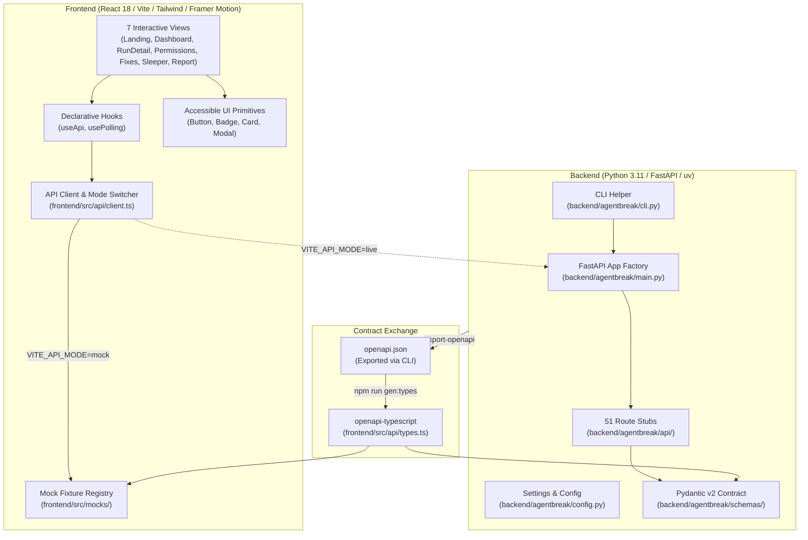
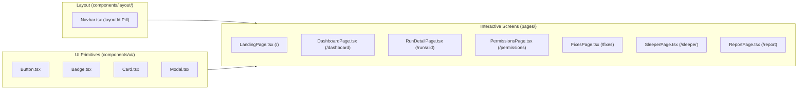

# Phase 1: Foundation and Setup — Architectural & Contributor Guide

> **Phase Status:** Complete (Milestones M1.1 through M1.6 fully implemented, verified, and quality-gated).  
> **Scope Boundary:** Phase 1 establishes the dual-stack development foundation (FastAPI backend + Vite/React frontend), validates all AgentDojo sandbox assumptions via a rigorous spike, freezes the OpenAPI contract with 51 route stubs, and delivers 7 fully interactive UI screens driven by typed mock JSON fixtures and MSW client interception.

---

## 1. Executive Summary & Goals

The primary objective of Phase 1 was to create a bulletproof, dual-stack engineering foundation for **AgentBreak**—an autonomous security-testing platform for AI agents. Rather than delaying user interface feedback until backend engines are fully built, Phase 1 employs a **contract-first, mock-first architecture**. 

By defining the complete Pydantic v2 API contract early, exporting it to OpenAPI, and generating TypeScript types, the frontend and backend were decoupled from day one. This enabled the complete implementation and interactive testing of all 7 core UI screens (including the three core differentiators: **Permission Diff (D1)**, **Fix Price Tag (D2)**, and **Sleeper Mode (D3)**) while the sandbox execution loop was being validated.

---

## 2. Milestone Breakdown (M1.1 – M1.6)

| Milestone | Title | Focus Area | Deliverables & Status |
|---|---|---|---|
| **M1.1** | **Repo & Tooling Scaffold** | Python 3.11 + FastAPI + uv; React 18 + Vite + TS + Tailwind | `pyproject.toml`, `package.json`, dual-stack linters (`ruff`, `eslint`), typecheckers (`mypy`, `tsc`), CI configurations. **Complete** |
| **M1.2** | **AgentDojo Spike** | Framework validation & package inspection | Spike script `scripts/spike_agentdojo.py` validating items V-01 through V-11 in Appendix A. **Complete** |
| **M1.3** | **Contract-First Schemas & Mocks** | 51 FastAPI route stubs, OpenAPI export, typed mock JSON | `schemas/`, `api/`, `openapi.json`, `types.ts`, mock fixtures in `frontend/src/mocks/`. **Complete** |
| **M1.4** | **Shell, Landing & Dashboard (Mock)** | Navigation shell, animated landing page, KPI tiles, charts | `Navbar.tsx` (`layoutId`), `LandingPage.tsx` (1-min demo modal), `DashboardPage.tsx` (Recharts). **Complete** |
| **M1.5** | **Run Detail & Permission Diff (Mock)** | Trace replay, PRE/POST state diff, visual attack graph, D1 screen | `RunDetailPage.tsx` (stepper, vector highlighting), `PermissionsPage.tsx` (Granted vs Needed vs Excess). **Complete** |
| **M1.6** | **Fix Lab, Sleeper & Report (Mock)** | D2 price tags, D3 sleeper timeline, reproducible report | `FixesPage.tsx` (Pareto badges), `SleeperPage.tsx` (cross-session memory diff), `ReportPage.tsx` (print-to-PDF). **Complete** |

---

## 3. System Architecture & Dual-Stack Design



---

## 4. Backend Implementation Architecture

### 4.1 Dependency Management & Tooling
- **Package Manager:** Astral `uv` pinned to Python 3.11 via `.python-version` and `pyproject.toml`.
- **Core Dependencies:**
  - `agentdojo==0.1.35`: Benchmark sandbox, tool wrapper runtime, and evaluation suites.
  - `fastapi>=0.110.0`: High-performance asynchronous REST API framework.
  - `pydantic>=2.6.0`: Strict data validation and schema generation (`extra="forbid"`).
  - `uvicorn[standard]>=0.29.0`: ASGI server implementation.
  - `httpx>=0.27.0`: High-level HTTP client for target probing and testing.
- **Code Quality:**
  - `ruff`: Lightning-fast linter and formatter configured for Python 3.11 conventions.
  - `mypy`: Static type analysis in strict mode across domain models and schemas.

### 4.2 Data Models & Contract Modules (`backend/agentbreak/schemas/`)
All models enforce explicit typing, immutability conventions, and strict validation:
- `common.py`: Operational schemas (`Health`, `Meta`, `Page[T]`).
- `target.py`: Target entity schemas (`Target`, `TargetCreate`, `TargetTestResult`).
- `suite.py`: Environment schemas (`SuiteInfo`, `ToolInfo`, `TaskInfo`, `ScenarioSpec`, `AttackCase`).
- `policy.py`: Security policy domain models (`Grant`, `Constraint`, `Policy`, `PolicyCreate`, `PolicyDiff`).
- `run.py`: Telemetry and trace schemas (`Run`, `RunCreate`, `RunSummary`, `TraceStep`, `SnapshotPair`, `Verdict`, `Evidence`).
- `finding.py`: Vulnerability tracking schemas (`Finding`, `FindingUpdate`, `AttackGraph`, `GraphNode`, `GraphEdge`).
- `sleeper.py`: Cross-session memory models (`SleeperRun`, `SleeperRunCreate`, `SleeperSession`).
- `discovery.py`: Autonomous exploration schemas (`DiscoveryCampaign`, `DiscoveryCreate`, `DiscoveryAttempt`).
- `audit.py`: Permission audit schemas (`PermissionAudit`, `AuditCreate`, `PermissionRow`, `EnabledExploit`, `AuditProof`).
- `fix.py`: Mitigation schemas (`FixSpec`, `FixSuggestion`, `PriceTag`, `FixEval`, `FixEvalCreate`).
- `dashboard.py`: KPI summaries and reporting (`DashboardSummary`, `Report`, `ReportCreate`, `DemoStatus`).

### 4.3 Route Stubs Registry (`backend/agentbreak/api/`)
In Phase 1, 51 endpoint stubs were implemented across 11 discrete router modules, returning HTTP 501 Not Implemented stubs with valid response models (except operational `/health` and `/meta`):
1. `system.py`: `GET /health`, `GET /meta`.
2. `targets.py`: CRUD operations + connectivity test stub (`POST /targets/{id}/test`).
3. `suites.py`: Suite metadata and attack case discovery.
4. `policies.py`: Policy CRUD and structural delta calculations.
5. `runs.py`: Run dispatching, trace inspection, snapshot diffs, and replay stubs.
6. `sleeper.py`: Multi-session lifecycle endpoints.
7. `discovery.py`: Autonomous fuzzing campaign management.
8. `findings.py`: Finding triage and attack graph aggregation.
9. `audits.py`: Permission audit generation and counterfactual attribution stubs.
10. `fixes.py`: Candidate fix suggestions and pricing evaluations.
11. `dashboard.py`: High-level metrics, demo execution, and Markdown reports.

---

## 5. AgentDojo Spike Results (`scripts/spike_agentdojo.py`)

The spike verified all assumptions regarding the third-party `agentdojo==0.1.35` package on Python 3.11 (Windows 11):

| Test ID | Spike Target | Verification Result |
|---|---|---|
| **V-01** | `TaskSuite` Factory | Exposes `.tools`, `.user_tasks`, `.injection_tasks`, and environment loaders. |
| **V-02** | `EnvTool` Wrapper | Wraps standard Python callables into Pydantic models with auto-generated JSON schemas. |
| **V-03** | Built-in Suites | Built-in suites (`slack`, `banking`, `workspace`, `travel`) load cleanly. |
| **V-04** | Attack Injection Points | Supports direct prompt injection and environment vector carriers. |
| **V-05** | Pipeline Interface | `AgentPipeline` implements `query(prompt, runtime, env)` returning history and costs. |
| **V-06** | Custom Environment Helper | Custom environment builder works smoothly for assembling our `acme` suite. |
| **V-07** | Execution Loop | Tool execution history is captured immutably in message lists. |
| **V-08** | In-Memory Isolation | Tools mutate local dataclasses in-memory with zero disk leakage. |
| **V-09** | Built-in Defenses | `DEFENSES` dictionary resides in `agentdojo.agent_pipeline.agent_pipeline`. |
| **V-10** | UV Resolution | 72 pure Python wheels resolved with zero local C-compilation steps. |
| **V-11** | Deepcopy Feasibility | Environment dataclasses support `deepcopy()` for deterministic PRE/POST snapshot diffing. |

---

## 6. Frontend Architecture & Design System

### 6.1 Design Tokens & Guidelines Compliance
Implemented according to the **UI/UX Pro Suite Design Rules**:
- **Aesthetic Direction:** Dark Minimalist Bento layout with subtle borders (`border-slate-800/80`) and layered elevation.
- **8pt Grid Spacing:** All margins, paddings, and layouts adhere to the `4px`, `8px`, `12px`, `16px`, `24px`, `32px`, `48px`, `64px` scale.
- **Typography:** Body text rendered at `16px` (`1rem`) with `1.5` line-height; titles use `text-wrap: balance`.
- **Framer Motion Presets:** Realistic spring physics (`damping: 25`, `stiffness: 300`) on navigation tabs, cards, and modal dialogs.
- **Accessibility & Contrast:** WCAG 2.2 AA compliant contrast (>4.5:1), explicit `aria-label` tags, focus-visible rings (`focus-visible:ring-2`), and non-color indicators (icons + badges).

### 6.2 UI Components & Screen Catalog



1. **Landing Page (`/`):**
   - High-impact hero section presenting AgentBreak's core value proposition.
   - Interactive 1-minute automated demo runner modal simulating live progression across audit, exploit, fix, and retest stages.
   - Feature highlight cards for Differentiator 1, 2, and 3.
2. **Dashboard (`/dashboard`):**
   - 4 high-level KPI tiles: Attack Success Rate (ASR), Benign Task Pass Rate, Open Findings, and Applied Fixes.
   - Recharts visual charts: Severity distribution bar chart and chronological vulnerability trendline.
   - Filterable recent runs table with execution status pills.
3. **Run Detail (`/runs/:runId`):**
   - Interactive chronological trace stepper with color-coded steps: amber for injected payloads, red for unauthorized actions, green for benign tool calls, slate for denied calls.
   - Side-by-side PRE and POST environment state diff viewer.
   - SVG-based visual attack graph linking entry vector $\to$ tool result $\to$ unauthorized action $\to$ impact.
4. **Permission Diff (`/permissions` — D1 Screen):**
   - Interactive breakdown of Granted (10 tools) vs Needed (8 tools) vs Excess (2 tools).
   - Counterfactual attribution table linking individual permissions directly to enabled exploit cases.
   - Proof of utility confirmation that legitimate workflows pass under the minimal policy.
5. **Fix Lab (`/fixes` — D2 Screen):**
   - Candidate mitigations catalog (e.g. removing excess permissions, restricting argument domains).
   - Two-dimensional price tags (`Attacks Blocked x/y`, `Legit Tasks Broken a/b`).
   - Pareto-optimal badges highlighting non-dominated fixes.
6. **Sleeper Mode (`/sleeper` — D3 Screen):**
   - Multi-session timeline visualizing cross-session memory poisoning: Session 1 (Plant) $\to$ Session 2 (Dormancy Gap) $\to$ Session 3 (Trigger).
   - Side-by-side memory state diff showing persistent payload survival across clean environment resets.
7. **Evidence Report (`/report`):**
   - Reproducible audit report rendered in GitHub-flavored Markdown.
   - Cryptographic run hashes and deterministic CLI replay commands.
   - One-click copy-to-clipboard, markdown file download, and clean print-to-PDF styles.

---

## 7. Quality Gate Execution & Verification

### 7.1 Backend Quality Gates
```bash
# 1. Run unit test suite
uv run pytest

# 2. Run Ruff linter and code formatter
uv run ruff check .
uv run ruff format --check .

# 3. Static type analysis in strict mode
uv run mypy backend/agentbreak

# 4. Export OpenAPI schema and verify contract stability
uv run python -m agentbreak.cli export-openapi --output openapi.json
```

### 7.2 Frontend Quality Gates
```bash
cd frontend

# 1. TypeScript static compilation check
npm run typecheck

# 2. ESLint code quality analysis
npm run lint

# 3. Vitest unit and smoke test suite
npm test

# 4. Production bundle build
npm run build
```

### 7.3 Running the Interactive Frontend in Mock Mode
```bash
cd frontend
npm run dev:mock
```
Navigate to `http://localhost:5173` to explore all 7 interactive screens powered by typed mock JSON fixtures.

---

## 8. Directory & File Map of Phase 1 Deliverables

```
backend/
├── pyproject.toml                         # Project configuration, dependencies, and tools
├── openapi.json                           # Frozen API contract exported via CLI
├── agentbreak/
│   ├── __init__.py                        # Package root (version 0.1.0)
│   ├── config.py                          # Pydantic Settings (environment configuration)
│   ├── main.py                            # FastAPI application factory and router mounting
│   ├── cli.py                             # CLI utility (export-openapi)
│   ├── schemas/                           # Pydantic v2 contract schemas
│   │   ├── common.py, target.py, suite.py, policy.py, run.py, finding.py,
│   │   ├── sleeper.py, discovery.py, audit.py, fix.py, dashboard.py
│   └── api/                               # 51 route stubs across 11 modules
│       ├── system.py, targets.py, suites.py, policies.py, runs.py,
│       ├── sleeper.py, discovery.py, findings.py, audits.py, fixes.py, dashboard.py
scripts/
└── spike_agentdojo.py                     # AgentDojo validation spike script (V-01..V-11)
frontend/
├── package.json, vite.config.ts, tsconfig.json, tailwind.config.js
├── src/
│   ├── main.tsx, App.tsx, index.css
│   ├── api/
│   │   ├── types.ts                       # Generated TypeScript definitions from openapi.json
│   │   ├── models.ts                      # Type aliases and convenience helpers
│   │   └── client.ts                      # API client with VITE_API_MODE mock interceptor
│   ├── mocks/                             # Typed mock JSON fixtures matching types.ts
│   ├── components/
│   │   ├── ui/                            # Button, Badge, Card, Modal primitives
│   │   └── layout/                        # Navbar with layoutId spring indicator
│   └── pages/                             # 7 interactive mock-backed application pages
│       ├── LandingPage.tsx, DashboardPage.tsx, RunDetailPage.tsx,
│       ├── PermissionsPage.tsx, FixesPage.tsx, SleeperPage.tsx, ReportPage.tsx
```
