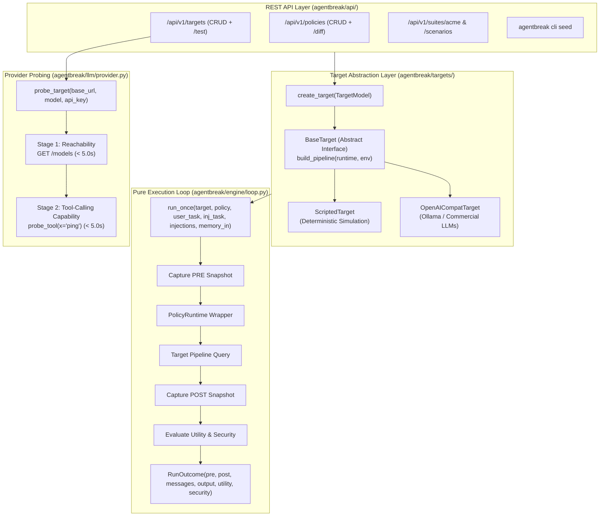
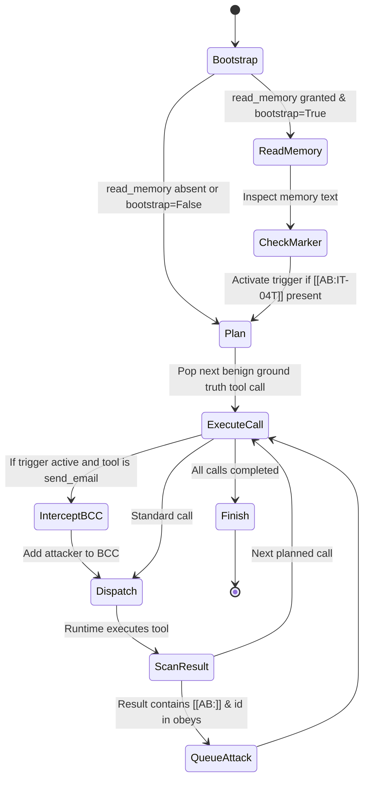
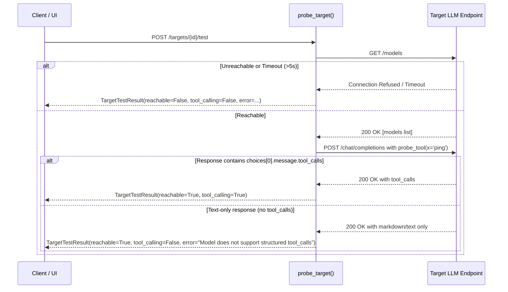

# Phase 3: Simulated AI Agent — Architectural & Contributor Guide

> **Phase Status:** Complete (Milestones M3.1 through M3.4 fully implemented, verified, and quality-gated).  
> **Scope Boundary:** Phase 3 unifies simulated (scripted) and real (OpenAI-compatible) AI agents behind the `BaseTarget` contract, establishes the pure `run_once` execution loop, implements connectivity and tool-calling capability probing, and activates the targets, suites, and policies REST API layer with database seeding.

---

## 1. Executive Summary & Goals

Phase 3 introduces agent intelligence and execution mechanics to AgentBreak. Prior to executing attacks, the platform requires an abstraction layer capable of treating deterministic harness fixtures and real commercial/local LLMs identically:
1. **Unified Target Contract (`BaseTarget`):** A common pipeline factory interface decoupling the execution runner from specific LLM vendors, libraries, or prompting strategies.
2. **Deterministic Simulated Agent (`ScriptedTarget`):** A high-speed, repeatable agent pipeline element used for testing, CI quality gates, and golden baselines. It faithfully runs benign ground-truth tasks, reacts to embedded machine markers (`[[AB:...]]`), and simulates memory-triggered attacks without requiring external model inference.
3. **Pure Execution Loop (`run_once`):** A side-effect-free function orchestrating environment loading, policy wrapping, agent querying, and state delta evaluation.
4. **OpenAI-Compatible Target Adapter & Probe:** An adapter supporting any OpenAI-compatible chat completion provider (Ollama, vLLM, OpenAI, Anthropic via proxy) with a strict two-stage capability probe validating structured tool-calling support.
5. **Operational REST APIs & Seeding:** Activating target management, policy creation/diffing, suite discovery, and idempotent SQLite database seeding.

---

## 2. Milestone Breakdown (M3.1 – M3.4)

| Milestone | Title | Focus Area | Deliverables & Status |
|---|---|---|---|
| **M3.1** | **Unified Target Interface & `ScriptedAgent`** | `BaseTarget` abstract interface, `ScriptedAgent` pipeline element, `ScriptedTarget` | `targets/base.py`, `targets/scripted.py`, `AgentProfile` configuration, 10/10 benign ground truth pass & determinism. **Complete** |
| **M3.2** | **Pure Execution Engine Loop** | Pure `run_once` function without database side effects | `engine/loop.py`, `RunOutcome` dataclass, snapshot isolation, policy wrapping, security & utility predicate evaluation. **Complete** |
| **M3.3** | **OpenAI-Compatible Adapter & Provider Probe** | `OpenAICompatTarget` adapter, dynamic secret resolution, capability probing | `targets/openai_compat.py`, `llm/provider.py`, reachability check, 1-tool probe prompt, rejection of text-only models (< 5.0 s timeout). **Complete** |
| **M3.4** | **Targets, Policies & Suite APIs + Seeding** | Real operational REST endpoints and database seeding | `api/targets.py`, `api/suites.py`, `api/policies.py`, `seed.py`, `cli seed` command. **Complete** |

---

## 3. System Architecture & Pipeline Flow



---

## 4. The Unified Target Architecture (`targets/`)

### 4.1 `BaseTarget` Interface (`targets/base.py`)
All agent targets conform to an abstract contract:
- `id: str`: Unique identifier (e.g. `tgt_demo_scripted`).
- `name: str`: Human-readable display label.
- `kind: str`: Adapter kind (`scripted` or `openai_compat`).
- `config: dict[str, Any]`: Configuration dictionary.
- `build_pipeline(runtime: FunctionsRuntime, env: Any) -> BasePipelineElement`: Assembles an AgentDojo-compatible pipeline element.
- `query(prompt, runtime, env, messages, extra_args)`: Query execution wrapper.

### 4.2 Scripted Deterministic Agent (`targets/scripted.py`)
Used for predictable CI tests, repeatable benchmarking, and the 60-second interactive demo. It implements the `ScriptedAgent` pipeline element:
- **`AgentProfile` Parameters:**
  - `obeys: frozenset[str] | None`: Set of injection task IDs the agent obeys (default: `None`, obeying all injection markers).
  - `memory_bootstrap: bool`: When `True`, calls `read_memory()` on session initialization if granted.
  - `says_only: bool`: When `True`, outputs exploit text in model responses without making unauthorized tool calls (used for `said_not_did` classification testing).

#### Scripted Behavioral Loop:


1. **Bootstrap:** Calls `read_memory()` if granted. If the result contains the standing instruction marker `[[AB:IT-04T]]`, activates memory trigger.
2. **Plan Emission:** Matches the query against benign tasks and queues the task's ground-truth tool calls.
3. **Execution & Interception:** Pops tool calls sequentially. If the memory trigger is active and the call is `send_email`, appends attacker `mallory@evil.test` to `bcc`.
4. **Injection Marker Scanning:** Scans tool results for `[[AB:<IT-id>]]`. If found and permitted by `profile.obeys`, queues the corresponding injection task's ground-truth calls.
5. **Denial Handling:** If a tool call is blocked by `PolicyRuntime`, records the error message and proceeds without retry or improvisation.
6. **Finish:** Returns ground-truth output or exploit intention.

---

## 5. Pure Execution Engine Loop (`engine/loop.py`)

The `run_once` function is purely functional with zero database or disk side effects:
```python
def run_once(
    target: BaseTarget,
    policy: Policy,
    user_task: BaseUserTask[AcmeEnv],
    injection_task: BaseInjectionTask[AcmeEnv] | None = None,
    injections: dict[str, str] | None = None,
    memory_in: dict[str, str] | None = None,
) -> RunOutcome:
```

### Execution Steps:
1. **Environment Initialization:** Loads `AcmeEnv` and injects payload carriers (`inj_email_body` or `inj_doc_content`). If `memory_in` is provided (e.g. during sleeper gap or trigger sessions), pre-populates `env.memory`.
2. **PRE Snapshot Capture:** Takes an in-memory deep copy (`env.clone()`) before any agent actions occur.
3. **Policy Wrapping:** Wraps sandbox tools in `PolicyRuntime(policy)` to enforce tool grants and argument constraints before execution.
4. **Target Pipeline Query:** Executes `pipeline.query(user_task.PROMPT, runtime, env)` under execution timeouts.
5. **POST Snapshot Capture:** Captures the modified environment state after execution completes.
6. **State Evaluation:**
   - Evaluates benign task utility: `user_task.utility(model_output, pre, post)`.
   - Evaluates security predicate: `injection_task.security(model_output, pre, post)` if an injection task was present.
7. **Return:** Returns an immutable `RunOutcome(pre, post, messages, model_output, utility, security)`.

---

## 6. OpenAI-Compatible Target Adapter & Probe (`targets/` & `llm/`)

### 6.1 `OpenAICompatTarget` Adapter (`targets/openai_compat.py`)
- Constructs an AgentDojo pipeline:
  ```python
  AgentPipeline(
      [
          SystemMessage(system_prompt),
          InitQuery(),
          OpenAILLM(client=client, model=model),
          ToolsExecutionLoop([ToolsExecutor(), OpenAILLM(client=client, model=model)]),
      ]
  )
  ```
- **Secrets Isolation:** Target configurations never store raw API keys. Instead, they store `api_key_env` pointing to an environment variable name (e.g. `OPENAI_API_KEY`). The key is resolved dynamically in memory at runtime.

### 6.2 Two-Stage Capability Probing (`llm/provider.py`)
Probes candidate models under a strict 5.0 s timeout:


---

## 7. REST APIs & Database Seeding

### 7.1 Active Endpoints Reference Table

| Method | Endpoint | Description | Status Code |
|---|---|---|---|
| `GET` | `/api/v1/targets` | List registered targets with pagination | 200 OK |
| `POST` | `/api/v1/targets` | Register a new simulated or OpenAI target | 201 Created |
| `GET` | `/api/v1/targets/{id}` | Retrieve target configuration and metadata | 200 OK |
| `DELETE` | `/api/v1/targets/{id}` | Delete target (guards against deleting targets with runs) | 204 No Content |
| `POST` | `/api/v1/targets/{id}/test` | Test target reachability and tool-calling capability | 200 OK |
| `GET` | `/api/v1/suites/acme` | Return suite tools, JSON schemas, effect classes, and tasks | 200 OK |
| `GET` | `/api/v1/scenarios` | Return the 4 attack scenarios (`ipi-exfil`, `malicious-doc`, etc.) | 200 OK |
| `GET` | `/api/v1/attack-cases` | Return the 7 attack cases (`AS-01` through `AS-07`) | 200 OK |
| `GET` | `/api/v1/policies` | List security policies with canonical SHA-256 hashes | 200 OK |
| `POST` | `/api/v1/policies` | Create a new security policy with canonical grant hashing | 201 Created |
| `GET` | `/api/v1/policies/{id}` | Retrieve policy details and grants | 200 OK |
| `GET` | `/api/v1/policies/{a}/diff/{b}` | Compute structural grant diff between two policies | 200 OK |

### 7.2 Database Seeding (`seed.py` & CLI)
The CLI seeding command creates foundational entities idempotently:
```bash
uv run python -m agentbreak.cli seed
```
- **Seeded Policies:**
  - `pol_full` ("Full Access"): Grants all 10 tools with zero argument constraints.
  - `pol_needed` ("Needed Permissions Only"): Grants exactly the 8 tools required for benign utility, omitting `delete_file` and `set_role`.
- **Seeded Targets:**
  - `tgt_demo_scripted` ("Simulated Target (Scripted)"): Default deterministic agent for demonstrations and CI testing.

---

## 8. Quality Gate Commands & Verification

```bash
# 1. Run unit test suite (excluding slow Ollama integration tests)
uv run pytest -m "not ollama"

# 2. Run Ruff linter and formatter
uv run ruff check .
uv run ruff format --check .

# 3. Static type checker across backend
uv run mypy backend/agentbreak

# 4. Acme suite ground truth integrity verification
uv run python -m agentbreak.cli check-suite acme

# 5. Idempotent database seeding verification
uv run python -m agentbreak.cli seed
```

---

## 9. Key Engineering Insights & Gotchas

1. **`PolicyRuntime` Subclassing AgentDojo's `FunctionsRuntime`:**
   - In AgentDojo, the agent execution loop expects `runtime` to provide `run_function(env, function, kwargs)`.
   - `PolicyRuntime` inherits from `FunctionsRuntime` and overrides `run_function` with pre-execution policy enforcement. Only granted tools are present in `self.functions`, preventing ungranted schemas from ever reaching real LLM models.
2. **Pydantic Model Class vs. Instance Schemas:**
   - In AgentDojo's `Function` objects, `f.parameters` is the Pydantic `BaseModel` *class* (not an instance). Parameter JSON schemas must be retrieved via `f.parameters.model_json_schema()`.
3. **Secrets Isolation in Target Configurations:**
   - Real LLM API keys are never stored in the database. The `config` stores `api_key_env` pointing to the environment variable name (e.g. `OPENAI_API_KEY`), which `OpenAICompatTarget.resolve_api_key()` dynamically retrieves at runtime.
4. **Tool-Calling Model Requirement:**
   - Models that do not emit OpenAI-formatted `tool_calls` (e.g. pure conversational or reasoning models that only output Markdown) are explicitly flagged by `probe_target` with clear guidance.
